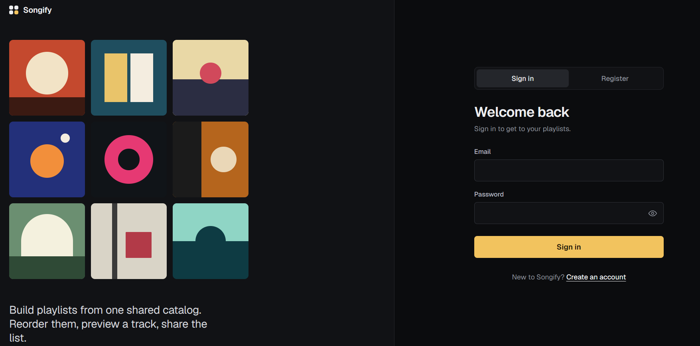
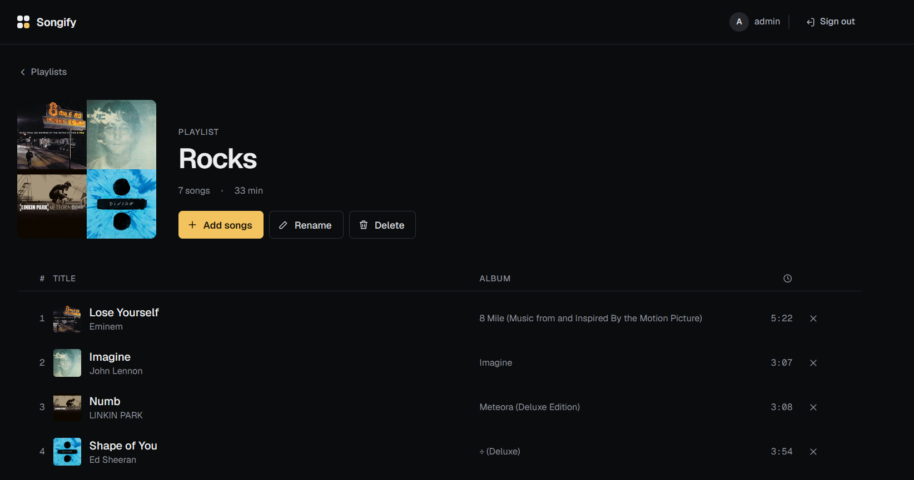
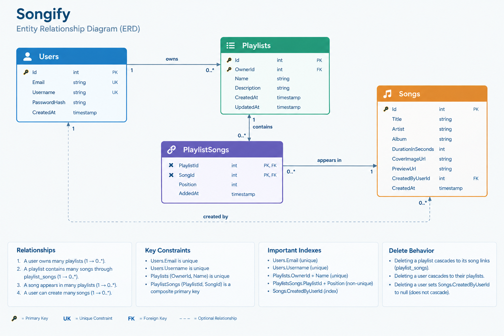

# Songify

A playlist manager: sign up, build playlists from a shared song catalog, reorder
them, and preview tracks.

Built with .NET 10 API, React frontend, PostgreSQL.

**Live:** [songify-blue.vercel.app](https://songify-blue.vercel.app) ·
**API:** [songify.runasp.net](https://songify.runasp.net) (Swagger at the root)

[](https://github.com/Ahmeddkhalill/songify/actions/workflows/ci.yml)





---

## Running it

You need Docker and the .NET 10 SDK. Node 20+ for the frontend.

```bash
git clone https://github.com/Ahmeddkhalill/songify.git
cd songify
```

Start the database, then the API:

```bash
docker compose up -d
cd backend
dotnet run --project src/Songify.Api
```

Docker starts PostgreSQL on port 5432 and nothing else. The API applies its
migrations and seeds the song catalog on first start, so there is no further
setup. Swagger is served at the root of whatever URL the API prints.

The frontend runs separately, in a second terminal from the repository root:

```bash
cd frontend
npm install
npm run dev
```

Vite serves it on `http://localhost:5173` and reads the API URL from
`VITE_API_URL`, defaulting to the local API.

Local development settings live in `appsettings.Development.json` and are
committed on purpose, so a reviewer can clone and run without filling anything
in. They are development values only. Production reads the same keys from
environment variables and refuses to start if one is missing.

### Tests

```bash
cd backend
dotnet test
```

Two projects: `Songify.Application.UnitTests` covers the services against an
in-memory context, and `Songify.Api.IntegrationTests` drives the real HTTP
pipeline against a PostgreSQL container started by Testcontainers. Docker has to
be running for the second one.

---

## The database

### Why PostgreSQL

The data is relational and the relationships carry weight: a user owns
playlists, a playlist holds songs, and the same song appears in many playlists.
That last one is a many-to-many that itself carries data — each entry has a
position and an added-at timestamp — so it needs a join entity of its own,
not a pair of embedded arrays.

The invariants that matter here are the kind a relational engine enforces for
you rather than the kind you hope the application remembers:

- a song cannot appear twice in the same playlist — the composite primary key on
  `(PlaylistId, SongId)` makes it impossible, not merely unlikely
- an email, and a username, is unique across all users — a unique index settles
  it even when two registrations race
- a playlist name is unique per user but free across users — a composite unique
  index on `(OwnerId, Name)` says exactly that
- deleting a playlist removes its song links and nothing else — the cascade is
  declared once, in the schema

A document store would have pushed every one of those into application code,
where a second process or a retried request can slip past them.

PostgreSQL over SQL Server specifically: functionally they are interchangeable
for this workload and EF Core supports both equally, so the decision came down
to operations. Postgres had a usable free tier on every host I evaluated, its
container image is small enough to pull quickly on any machine, and
Testcontainers brings it up fast enough to run integration tests on every build.
Since the project is Code First, moving to SQL Server would be a provider swap
and a regenerated migration.

### Schema



Positions are kept contiguous from zero. Adding, removing or moving a song
renumbers the affected rows in the same `SaveChanges`, so the ordering cannot
drift into gaps or duplicates.

---

## Architecture

Clean Architecture, four projects:

```
Songify.Domain          knows nothing
Songify.Application     knows Domain
Songify.Infrastructure  knows Application
Songify.Api             knows Application + Infrastructure
```

The arrow that is missing is the deliberate one: Application never references
Infrastructure. It declares `IApplicationDbContext` and the Infrastructure's
`ApplicationDbContext` implements it, so the services write ordinary EF queries
without the Application layer knowing which provider is behind them.

### Why no repository layer

`DbContext` is already a unit of work and `DbSet<T>` is already a repository.
Wrapping them would add indirection for its own sake and would cost the things
that make EF worth using — projections straight into response records, `Include`
where a graph is genuinely needed, `AsNoTracking` on reads. The dependency is
inverted through `IApplicationDbContext`, which is what the unit tests are
written against.

### Why anemic entities and a service layer

The entities are plain property bags; the rules live in the services. A rich
domain model with private setters and factory methods is the stronger pattern
for a large domain with real invariants spread across aggregates, but this
domain has few rules and most of them need a database query to evaluate — is
this name taken, is this song already in the playlist — which an entity cannot
do on its own. The trade-off is real and known: with the rules outside the
entity, nothing stops a future caller from mutating state directly. At this size
I preferred the design I can read top to bottom over the one that is more
defensible in the abstract.

### Error handling

Expected failures return a `Result`, not an exception. Exceptions are for the
cases that should not happen.

- `Result` and `Error` live in `Application/Abstractions`
- `Application/Errors` holds one static catalog per entity, each entry carrying
  its own HTTP status
- `Api/Extensions/ResultExtensions.ToProblem()` turns a failed result into
  `ProblemDetails`

That extension sits in the API layer, not the Application layer, on purpose:
mapping an error to an HTTP status is a transport concern, and the Application
layer should not know that HTTP is what is calling it.

Controllers are one line of translation:

```csharp
return result.IsSuccess ? Ok(result.Value) : result.ToProblem();
```

Anything genuinely unhandled is caught by `GlobalExceptionHandler`, an
`IExceptionHandler`, which returns the same `ProblemDetails` shape so clients
parse one error format throughout. That response carries a trace id and nothing
else — no exception message, type, or stack trace. The full exception goes to
the log under the same id, so a user can quote it and the matching line is one
search away.

### Validation, in two layers

Structural validation — format, length, required — lives in FluentValidation
beside each request record and runs before the action is reached. Semantic
validation — is this email taken, is this playlist yours, is this song already
in it — lives in the service, because it needs a query. Mixing them is how
validators end up holding a `DbContext`.

### Authorisation

Playlists belong to exactly one user. Every read and every write loads the
playlist and compares `OwnerId` to the caller before doing anything; a mismatch
is 403 and a missing playlist is 404. No endpoint trusts an id on its own. The
integration tests cover this from the outside — a second user is rejected on
read, update, delete, add-song, remove-song and reorder.

Seeded catalog songs have a null `CreatedByUserId` and are immutable to
everyone, since they appear in other people's playlists. A song a user adds
themselves is theirs alone to change. Ownership-per-row covers every rule this
application actually has, which is why there are no roles.

### Authentication

JWT, issued on register and login, validated with issuer, audience, lifetime and
signing key, and `ClockSkew` set to zero so expiry means expiry.

Passwords are hashed with ASP.NET Identity's `PasswordHasher` — PBKDF2 with a
per-password salt — reached through a small `IPasswordHasher` of our own so the
Application layer takes no dependency on Identity. The full Identity stack was
not used: it would have brought tables for roles, claims, logins and tokens that
this application has no use for, and its `IdentityDbContext` would have pulled
EF Core into the Domain project.

A wrong password and an unregistered email return the same status and the same
error code. Distinguishing them would hand an attacker a way to find out which
addresses have accounts.

---

## API

All playlist and song endpoints require a bearer token.

| Method | Endpoint | Auth | Description |
|---|---|---|---|
| POST | `/api/auth/register` | — | Create an account, returns a token |
| POST | `/api/auth/login` | — | Returns a token |
| GET | `/api/playlists` | required | The caller's playlists |
| GET | `/api/playlists/{id}` | required | One playlist with its songs in order |
| POST | `/api/playlists` | required | Create a playlist |
| PUT | `/api/playlists/{id}` | required | Rename or re-describe |
| DELETE | `/api/playlists/{id}` | required | Delete, cascading its song links |
| POST | `/api/playlists/{id}/songs` | required | Append a song |
| DELETE | `/api/playlists/{id}/songs/{songId}` | required | Remove and renumber |
| PUT | `/api/playlists/{id}/songs/{songId}/position` | required | Move within the playlist |
| GET | `/api/songs` | required | Paged catalog search |
| GET | `/api/songs/{id}` | required | One song |
| POST | `/api/songs` | required | Add a song of your own |
| PUT | `/api/songs/{id}` | required | Edit a song you added |
| DELETE | `/api/songs/{id}` | required | Delete a song you added |
| GET | `/health` | — | Liveness, including the database |

`GET /api/songs` takes `searchValue`, `pageNumber` and `pageSize` as query
parameters, defaulting to page 1 with 10 per page and capped at 50. The search
matches title and artist. The response carries the items alongside the total
count and the page metadata.

Swagger is enabled in production so the deployed API can be exercised directly.
That is deliberate for this review; outside it, it would stay
development-only.

---

## Frontend

React 19, TypeScript, Vite, Tailwind v4.

The visual design was produced first and exported as HTML and design tokens into
`docs/design/`. The token set — the ink scale, one amber accent, a danger scale,
the type scale and the radii — is declared once in `src/index.css`, so no
component carries its own colours or spacing.

Points worth noting:

- One axios instance normalises the API's two error shapes — the Result
  pattern's code-and-message object and FluentValidation's field map — into a
  single object, and clears the session on a 401.
- Client-side validation mirrors the server's validators so an obviously bad
  form never reaches the network, but a server error always renders. The server
  stays the authority.
- Mutations apply optimistically and roll back on failure, so removing a song or
  moving a row feels immediate.
- Search is debounced and cancels the in-flight request, so a slow earlier
  response cannot overwrite a newer one.
- 403 and 404 render identically on a playlist: someone else's playlist should
  read as simply not there.

---

## Scope decisions

**No audio hosting.** A `Song` is metadata. The requirements are about managing
playlists, not streaming, and hosting copyrighted audio is not something a
project like this can do lawfully. Cover art and the 30-second previews are
public iTunes URLs, fetched once by `tools/fetch-seed-songs.mjs` and stored as a
seed file — the application hosts no media.

**No refresh tokens.** Access tokens are short-lived. Refresh would bring a
token store, a rotation policy and revocation — real work for a requirement that
was never stated.

**No social login.** The `User` entity would need a nullable `PasswordHash` plus
provider columns, and a policy for when an OAuth email matches an existing local
account. Deferred as out of scope.

---

## Deployment

| | |
|---|---|
| Frontend | Vercel — [songify-blue.vercel.app](https://songify-blue.vercel.app) |
| API | MonsterASP.NET — [songify.runasp.net](https://songify.runasp.net) |
| Database | Managed PostgreSQL, alongside the API |

The API reads `ConnectionStrings__Default` and the `Jwt__*` keys from the
environment and fails at startup, naming the missing setting, if one is absent.
`Cors__AllowedOrigins__0` holds the frontend origin. No secret is committed to
this repository.

---

## AI-assisted development

I used AI throughout, and picked the tool by the kind of task rather than
sticking to one:

- **GitHub Copilot** — most of the time, for completions while writing code.
- **Claude** — talking through architecture, reviewing decisions, and the
  conventions in `CLAUDE.md`.
- **Claude Code** — implementing some parts against those conventions.
- **Claude's design tool** — the interface. The canvas is open to view:
  [Songify design canvas](https://claude.ai/artifact/Fod1Bdfirrie86vkhDoVpP).
  Its artboards and tokens are exported into `docs/design/`.
- **ChatGPT and Gemini** — individual questions along the way.

The architecture, the database choice, the ownership model, the error-handling
approach and the scope boundaries above are my decisions. Several came out of
disagreeing with a first suggestion:

- The first proposal was a rich domain model with private setters and factory
  methods. I chose the service-oriented design instead, for the reasons in the
  architecture section.
- The suggested Result pattern was replaced with the implementation I already
  use, and `ResultExtensions` was moved out of the Application layer once it was
  clear that translating a result into HTTP is the API's job.
- A proposed deployment host was abandoned when it turned out to require a card,
  and the database moved to the API host's own Postgres once an external
  connection proved impossible through the free tier's outbound firewall.

---

## Repository

```
backend/
  src/
    Songify.Domain/          entities
    Songify.Application/     services, contracts, validators, result pattern
    Songify.Infrastructure/  EF Core, migrations, seeding, JWT, hashing
    Songify.Api/             controllers, middleware, DI
  tests/
    Songify.Application.UnitTests/
    Songify.Api.IntegrationTests/
frontend/                    React client
docs/design/                 exported artboards and design tokens
docs/screenshots/            screenshots and the ER diagram
tools/                       seed-data generator
docker-compose.yml
CLAUDE.md
```

Work was done on feature branches merged through pull requests, with
Conventional Commits throughout. The pull request descriptions carry the
reasoning behind each change.
